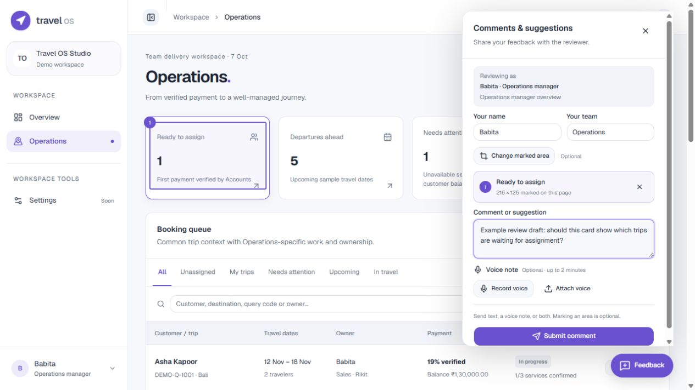

# Preview comments and suggestions

Updated 2026-10-08. Status: implemented local reviewer inbox; team validation pending. Sources: FB-020/021/036 in the [feedback register](../../feedback/README.md), [decision 0008](../../decisions/0008-local-review-inbox.md). This stores real review submissions independently of simulated business records.

## Pages and users

The floating **Feedback** button appears on login and every workspace page, including Sales, Operations, Accounts and their detail views. The panel says **Comments & suggestions**, **Share your feedback with the reviewer**, and **Submit comment**. It does not describe an assistant, automated implementation or an external recipient.

FB-036: shared identity shape now also accepts the separate DMC session. On DMC routes it captures the DMC identity/role (or Before sign-in), not an existing CRM session. Reservations defaults the editable team to Reservations. No review storage format or submission authorization changed; actual attribution remains reported demo context.

Opening the panel captures the current demo identity ID/name, role label, full URL including hash route, page title and preview version. **Your name** and **Your team** are required, editable and prefilled from the demo session. Actual reviewer name/team and selected demo identity/role are stored separately: someone reviewing as Babita need not be Babita. Before login the role is **Before sign-in**, with no demo identity. These are reported context, not authenticated attribution; see [AS-020](../../product/assumptions.md).

## Actions and states

- Submit a general comment, mark an area, attach/record a voice note, or combine text and voice. A mark is optional; text or voice is required. Text is limited to 5,000 characters.
- **Mark an area** temporarily hides the panel and intercepts page interaction. Click an element or drag a rectangle; cancel/Escape returns to the draft. A saved mark retains viewport rectangle/dimensions, scroll offset, CSS selector, section label and visible text excerpt. The panel shows a numbered highlight and permits changing/removing it. Marks refer to the captured layout; selectors can become stale after a redesign. No screenshot is captured or stored.
- **Record voice** requests microphone access only when pressed, with Stop, elapsed time, replay, replace and remove controls. Recording stops at two minutes or the size limit; closing/navigating ends capture. HTTPS or localhost and a supporting browser are required. Unsupported/denied/failed capture explains the problem and offers text or file attachment.
- **Attach voice** accepts WebM, Ogg, M4A/MP4 or WAV up to 8 MB. Browser recordings are duration limited; uploaded duration is not decoded/enforced. Server validates the container signature, format and size; it does not transcribe or fully decode media.
- Submitting disables edits and shows progress. Server/validation/network errors keep the draft open for retry. Exact retries reuse a request ID and create one record; a changed payload with that ID is rejected. A success appears only after the local server returns a saved ID. **Add another comment** or **Done** completes the flow.
- Drafts survive closing/reopening within the same page/session; navigation or demo identity changes clear them to avoid crossing role context. Unsaved drafts are not durable across reloads. Submitted records remain when CRM/booking samples reset.

The nonmodal panel uses Radix dialog semantics and focus restoration, keeps its own scrolling and does not lock the document scrollbar. The selection layer supports pointer input. Its controls use shared shadcn buttons/inputs and theme tokens.

Shared app dialogs also expose **Comment on this form** inside their keyboard focus scope. During feedback/marking, that dialog temporarily allows the overlay to receive focus and prevents outside/Escape dismissal; closing feedback restores its normal modal behavior. The draft and form remain available without confirming the underlying booking action.

Set `VITE_REVIEW_VERSION` before a shared build to label its revision. The current fallback is `review-2026-10-07`; it is not an automatically unique build ID.

## Storage and service boundary

`ReviewService.submit` posts JSON to **POST /api/review/comments**. The Vite development and preview middleware use Node 24 built-in SQLite, without a new dependency or hosted service. `data/review/review.db` stores submission metadata/text plus audio as a BLOB. Stable `RV-…` IDs, UTC timestamps, initial `pending` status and separate reviewer notes support follow-up. `data/review/issues.md` is a derived local issue list regenerated from the database after writes/updates. The database is authoritative; a ledger write failure does not discard the saved comment.

All inbox files/audio/exports are ignored by Git. The review store is separate from existing planner `data/travel_os.db` and per-browser CRM/booking localStorage. It shares comments received by this running host; it does not share mock booking mutations between browsers.

The website exposes only submission and a capability status endpoint, with no list/read/update/audio-download endpoints. Request origin/host checks allow configured loopback ports and `crm.meerasansthan.org`; JSON size is bounded and submissions rate limited by connection address. Local inbox paths are denied by Vite's file serving. These checks do not authenticate the demo identity or replace production permissions. Access control, retention, backups and verified reviewer login need a separate decision before broader production use. An existing reverse proxy may aggregate the connection-based rate limit across reporters.

## Local review workflow

Keep the existing local Vite server running behind the user's review domain/proxy for submissions to reach this computer. No new public routing, account, hosted integration or background agent was configured. A static `dist` upload alone has no inbox API; it reports a submission error and retains the draft. `npm run preview --prefix apps/web` serves the built preview with the local inbox on loopback port 4173; the existing `npm run dev:web` uses 5173.

From the repository root:

```sh
npm run review:list
node tools/review/manage.mjs show RV-<id>
node tools/review/manage.mjs export RV-<id>
node tools/review/manage.mjs update RV-<id> in-progress --note-file <local-note.txt>
```

Export creates readable JSON and an audio file, if present, under ignored `data/review/exports/`. The local list contains reviewer/demo role, route, version, mark, original text/voice indicator and reviewer notes. Use the command to update SQLite; editing the derived Markdown alone does not update status. Available statuses are **pending → in-progress → ready-to-recheck → resolved**, with **needs-clarification** when a question remains; statuses may be moved back during review. Status updates preserve the original submission, but a full status-change history/thread is not implemented.

The user asks in this chat to inspect/discuss a batch. Read its original text/audio/context as evidence, agree the intended changes, update reviewer notes/status and link substantive requirements to the project feedback register. Implementation is ready-to-recheck; only reviewer/client validation makes it resolved. No notification, transcription, automatic chat delivery, screenshot export, public board, reply thread or unsolicited reviewer message is implemented.

## Verification

- `npm run build:web`: TypeScript and Vite build passed; existing large-bundle warning remains.
- `npm run test:web`: 23 existing workspace/CRM/booking tests passed. `npm run test:review`: three checks passed for durable general/marked/voice records and identity metadata, local ledger/export inputs, status updates, retry deduplication, invalid payloads, allowed submission, rejected origin/host and unavailable read endpoints. Root `npm test` remains a failing placeholder.
- Chromium at 1265 × 720, light: login button, Sales general and marked text/attached one-second synthetic WAV, saved receipt, local audio export, Babita Operations manager context and rectangle selection checked. Final neutral form/section label/Submit control and Escape focus restoration checked. Open assignment dialog → Comment on this form → mark owner field → Escape returned to the retained form without assigning a booking. Three verification submissions were marked resolved with notes and retained, rather than mixed with client requests. Real microphone capture and new mobile/dark review remain unverified.
- Local HTTP checked the inbox ledger is blocked through Vite's filesystem route and is not exposed by the normal application fallback. No external domain/proxy/TLS test or actual microphone recording/permission test was performed. File attachment and persisted audio bytes were verified.
- Built-preview smoke check on loopback 4173 returned the page and inbox capability status successfully. Fifteen affected documents/160 local links checked with no missing targets or trailing whitespace; database/ledger/audio exports confirmed ignored by Git.


