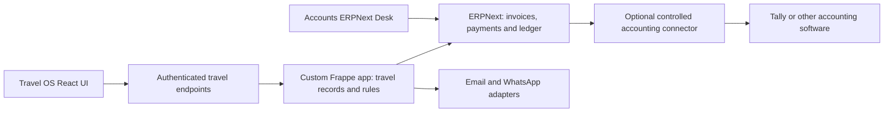

# ERPNext / Frappe evaluation for Travel OS

Researched 2026-10-09 under FB-051. **Recommendation for discussion; no backend selected or installed.** Public official documentation and project-maintainer READMEs were read in the browser. Published capabilities are not tested Travel OS integrations. Existing mockups, local data and access rules are unchanged.

## Recommendation

If the client is willing to use ERPNext for its books, the strongest candidate is **the existing React/shadcn Travel OS UI + a custom Travel OS Frappe app + ERPNext accounting**. Keep the standard accounting engine and extend it through supported app hooks; avoid editing ERPNext core. Accounts can initially use the standard ERPNext Desk for complex finance work while Sales/Ops use the focused custom UI. A completely custom accounting UI can follow only where actual staff tasks justify its maintenance.

If the accountant intends to keep Tally or another package as the official books, compare a **custom operational backend with a controlled accounting connector** first. Frappe alone is one candidate for that backend, alongside the existing-stack/custom-backend option. Installing ERPNext solely to maintain a second editable ledger can add more reconciliation work than it removes.

The choice depends on the incumbent software/version, legal entities, accountant acceptance, travel-tax treatment and deployment/permission feasibility. These remain AS-025–027. [Proposed decision 0013](../decisions/0013-travel-accounting-backend-evaluation.md) records alternatives and the validation gate.

FB-052 follow-up: [travel-app shortlist](erpnext-travel-apps-research.md) verifies Solufy's commercial Tours And Travels listing, two public travel repositories, newer community hotel PMS and archived official Hospitality. Solufy is the closest published catalog/contract/package match, but source access, current availability/support and our workflow/API fit remain unverified. No complete maintained public DMC solution was established in this bounded review; no add-on is adopted.

FB-053 follow-up: [offline travel inventory evaluation](erpnext-travel-inventory-evaluation.md) verifies batch expiry, stock reservations, supplier-specific dated Item Prices and inventory dimensions. Standard Stock is a potential adaptation for fixed date/flight blocks, not a complete hotel-night/airline availability engine. Proposed custom contract/rate/dated-allotment logic must distinguish price validity, service dates, holds and supplier releases; AS-028 tracks actual contract types. Evaluation only, no module adopted.

## What we know about this client's workflow

FB-056 follow-up, researched 2026-10-10: [standard Frappe app reuse map](frappe-standard-apps-evaluation.md) identifies ERPNext/CRM as initial candidates and Helpdesk/Insights as optional additions; HR/Drive/Learning and Builder address later needs. Standalone CRM differs from ERPNext's CRM module. Official docs verify deal-to-customer/quotation linkage and same-site item/product sync, a Sales Hierarchy, and a CRM WhatsApp interface requiring the community connector. Proposed architecture/adoption status remains unchanged.

| Basis | Relevant need | Implication for evaluation |
| --- | --- | --- |
| User-confirmed B2C handoff, FB-016; [review](operations-accounts-review.md), [Accounts mockup](../modules/accounts/README.md) | Sales submits token/partial/full receipt evidence; Accounts verification releases Ops manager assignment | Evidence submission, receipt verification, ledger posting and Ops readiness need separate states |
| User-described [Bali B2B process](bali-dmc-team-flow.md), FB-037 | Ops combines outreach, quotation/negotiation and fulfillment; locked deal + token precedes actual supplier booking work; Accounts handles incoming/outgoing money | Compose access roles around functions; do not impose the separate B2C Sales-to-Ops handoff on Bali |
| Participant-reported [Babita discussion](babita-operations-discussion.md), FB-039 | Accepted Sales itinerary, alternative procurement sources, different supplier cutoffs, team cover and nearby departure/arrival tasks | Preserve promised services versus actual purchases, independent deadlines and shared team scope |
| Header-only [client sheet evidence](../references/client-sheets/README.md) | Sale amounts, vendor/payment fields, taxable value, GST/TCS/remittance and Profit/Additional Profit columns | Field labels establish a need to investigate, not accounting formulas or validated tax policy |
| Saved [Sembark evidence](../references/sembark/screens/12-trip-quote-booking-accounting-workspace.md) | Trip, supplier bookings, payment instalments, accounting/docs/history | Useful structural reference; does not prove ERPNext fit or the client's accounting policy |
| FB-038 and [permission direction 0011](../decisions/0011-configurable-users-roles-and-permissions.md); FB-044 | Configurable users/roles; separate B2C/B2B URLs; Sales supplier costs/markup restricted to manager/admin in the current itinerary demo | Backend record/field enforcement must match each workflow's reviewed access policy; URLs alone do not isolate data |

Current Accounts is a receipt/payable mockup, **not double-entry accounting**. It has no real bank reconciliation, invoice/tax engine, refunds, foreign-currency settlement or statutory books. ERPNext could provide much of this foundation; the current demo does not already implement it.

## The options are different layers

**Frappe Framework** is the Python/JavaScript application framework: DocTypes (record definitions), generated APIs/admin forms, users/permissions, jobs and extension hooks. **ERPNext** is the business application built on Frappe, including accounting, customers/suppliers and sales/purchase documents. Frappe alone does not include ERPNext's ledger. **Headless ERPNext** means using that same server/application through APIs behind another UI; it does not remove the ERPNext data model, validations, operations or licensing.

| Option | Strength | Work still required | Assessment for this project |
| --- | --- | --- | --- |
| Standard ERPNext Desk, configured/customized | Quickest access to established accounting and administrative screens | Travel records, trip-specific flow, staff training and workflow fit | Useful Accounts evaluation surface; a standard ERP screen is unlikely to satisfy the entire travel experience |
| Frappe-only custom app | Reuses records/forms, permissions, API, jobs and admin tools | All travel rules; an external accounting adapter or a separately implemented ledger | Worth comparing when Tally stays authoritative; not a shortcut to full accounting |
| ERPNext + custom Frappe app + React UI | Reuses accounting while preserving the client-focused itinerary/Ops experience | Travel domain, role-safe endpoints, integration mapping, custom frontend, upgrade checks | Preferred candidate if ERPNext becomes the books |
| Custom backend + Tally/other adapter | Maximum independence; keeps accountant's existing tool | Production identity, authorization, audit, jobs and sync must be built/chosen | Serious alternative if incumbent accounting remains; compare operational effort rather than assuming Frappe is always simpler |

No numerical score or delivery estimate is justified before a workflow spike and accounting review.

## Proposed ownership and headless design

This diagram is a **candidate when ERPNext owns the books**, not an adopted deployment. If Tally owns the books, the operational service would instead export approved accounting events to Tally and store its posting/reconciliation acknowledgements; ERPNext need not sit in between.

Frappe generates `/api/resource/{DocType}` CRUD endpoints and exposes whitelisted Python functions through `/api/method/...`. Official documentation describes user sessions, API-key authentication and OAuth access tokens. This supports keeping our React/shadcn UI; Frappe UI's Vue components are an alternative, not a frontend requirement. [S1–S3, S12]

Use travel actions such as `accept_quote`, `verify_receipt`, `request_supplier_payment` and `release_voucher` with server validations instead of assembling a business transaction from unrelated browser CRUD calls. Custom records should own travel-specific meaning. The endpoints can live in the custom Frappe app; a separate Node backend is not inherently necessary. Prefer a same-origin session arrangement or a reviewed OAuth design; an additional frontend gateway is an option when hosting/identity require it.

- Keep API secrets server-side. Never put an Administrator key in frontend code.
- Preserve the actual staff identity in authorization and audit. A shared service credential cannot automatically reproduce each user's permissions; a gateway using one needs its own authoritative actor/scope checks.
- Keep a stable company/trip/service/quote-version ID on integration records. Use permission-filtered responses for Sales, Ops, Accounts and external agencies.
- Submit financial documents through ERPNext controllers/workflows so validations and ledger posting run. Do not write directly to ledger tables or bypass controllers for convenience.
- For external sync, record the approved event and queue it reliably after the business transaction commits. Retrying must not duplicate a receipt/invoice. Track pending/posted/failed status, external IDs, conflicts and reviewed reversals. A failed Tally export must remain visible as unsynchronized.

### Candidate record mapping

| Travel concept | Candidate ERPNext/Frappe mapping | Important boundary |
| --- | --- | --- |
| Agency/business payer | Customer + Contact; agency organization linked separately for access | A traveler is not automatically the invoice party. Different legal companies may need distinct master mappings |
| Day-wise itinerary, quote revisions and acceptance | Custom Travel Query/Itinerary/Quote Snapshot | Standard Quotation may hold commercial lines, but does not by itself represent hotel alternatives, dated day plans or immutable accepted scope |
| Trip and supplier service booking | Custom Travel Trip + Supplier Service Booking | May link Project/Sales Order/Purchase Order where useful; an ERP order is not evidence of an actual reservation/confirmation |
| Supplier commitment, bill and payment | Purchase Order where applicable → Purchase Invoice → Pay Payment Entry | A quoted cost, confirmed reservation, supplier invoice and money paid are different facts; advances can precede invoices |
| Customer invoice and collection | Sales Invoice + Receive Payment Entry/advance | Receipt proof is initially unverified operational evidence. A draft does not post; submission creates ledger entries. Decide when verification permits posting |
| Pending receipt and payment authorization | Custom Receipt Evidence/Payment Approval and/or reviewed Workflow | Never let a screenshot alone mark a bank receipt settled; record who checked the evidence and later reconciliation |
| Trip profitability | Trip/project/accounting dimension linked consistently to financial documents; custom report if needed | Separate quoted margin, estimated procurement margin, booked revenue/cost, realized FX/fees, refunds and cash movement |
| Voucher and travel deadlines | Custom release rule, documents/tasks and date reminders | Invoice settlement does not prove supplier confirmation or determine voucher policy |

ERPNext Payment Entry supports advances, partial receipts, multiple invoice allocations for one party, supplier payments and internal transfers. An unallocated advance can be matched later. Submitting creates GL entries; a receipt normally settles a receivable and does not book revenue again. The accountant must determine recognition timing and advance treatment for this travel business. [S4]

ERPNext supports account/company/transaction currencies and FX differences, but we must model INR/USD/IDR ledgers, rate approval, bank/card fees and remittance correctly. Simply enabling multiple currencies will not define the client's policy. [S5]

India Compliance is a separate app with published GST, e-Invoice, e-Way Bill, TDS/TCS capabilities, subject to versions/configuration. That is not evidence that this client's overseas tour-package TCS, principal-versus-agent treatment, cancellations or remittance workflow are covered automatically. Validate real redacted examples with Accounts/CA; statutory API services may have separate commercial terms. No tax rate or formula is selected here. [S6]

## Roles and access in Frappe

Frappe permits multiple roles per user. Role permissions control DocType actions including Read, Write, Create, Submit, Cancel, Amend, Report, Export, Print, Share and Email. Field permission levels group sensitive fields under different roles. User Permissions restrict linked values such as Company or Customer. Pages/reports have access controls. These are substantive backend building blocks, not just menu hiding. [S2]

Suggested functions below are **examples to review**, not new grants:

| Function | Proposed scope/actions | Restrictions to review |
| --- | --- | --- |
| Sales executive | Assigned leads, draft itineraries, customer quote values, submit receipt evidence | No supplier cost/margin payloads; no receipt verification or ledger submission |
| Sales manager | Team assignment/reassignment, quote approval and reviewed cost/margin access | Does not automatically acquire Accounts/payment authority |
| Ops handler/team | Relevant shared trips, suppliers/holds/confirmation, travel tasks, payment requests | Team collaboration need not imply financial approval; B2C and Bali policies differ |
| Accounts preparer/reviewer | Receipt checks, invoice/payment preparation, liabilities and reconciliation in allowed companies | Separate prepare/approve/post/reverse where required |
| Financial approver | Reviewed payment/exception thresholds | Amount/vendor/state conditions must be checked server-side |
| External agency user | Its own quotes/bookings, permitted customer prices and documents | No other agency records, procurement cost, unrestricted exports or supplier bank details |
| Access administrator | Reviewed role/user management | Control who can grant financial or cross-company access; admin convenience is not a segregation-of-duties policy |

For Bali, an Ops member can receive both commercial and fulfillment roles. Roles generally add grants; an extra role can widen cost or record access. Define the effective policy rather than assuming a restrictive role cancels a permissive one. Frappe's **owner** restriction means the document's creator, not necessarily our current assignee/handler. Assignment/team-cover access needs an explicit travel rule.

Link-based User Permissions are useful, but advanced assigned/team/agency logic requires server-side document checks and permission query conditions. Apply the same scope to lists, direct document reads, link searches, child records, attachments, reports and exports. The documented `get_list` applies user permissions; `get_all` does not. Whitelisting a custom method only exposes it to the API—it does not write its business authorization for us. [S3, S7–S8]

Frappe sites each have their own database. Site-per-independent-client is a candidate for a future multi-client product. Multiple ERPNext Companies within one site are accounting entities and must not be mistaken for automatic tenant isolation. External agencies inside one DMC site still need agency scope. Separate B2C/B2B URLs do not answer whether their records/legal books should be shared. [S9; AS-002]

## Can we develop it with AI?

**Yes—AI-assisted development is practical.** Record metadata, controllers, hooks, API functions, reports and client UI are ordinary repository artifacts. AI can scaffold custom DocTypes, workflows, fixtures, Python services, print formats, tests and React adapters. Generated admin forms can reduce repetitive work. The main learning curve is Frappe's lifecycle, submission/cancellation, permissions, migrations and accounting document relationships. [S1, S7, S12]

For maintainability, put travel logic in a versioned custom app with exported configuration/fixtures and migration patches. Avoid accumulating untracked Desk edits and scattered server scripts. Server-script availability/constraints depend on deployment; they are not a substitute for a custom application. Pin compatible Frappe, ERPNext, India Compliance and add-on versions, then check upgrades. The documented `extend_doctype_class` hook is v16+; a v15 design must use its supported extension mechanisms. [S7]

Future production work needs meaningful checks for duplicate posting, invalid transitions, monetary/FX calculations, approval separation, cross-agency access, cost leaks, rollback and cancellation/refund recovery. Quick mockup speed does not establish financial correctness. No application tests ran for this research; FB-045's UI-only preference remains for current mockup work.

### MCP options verified

| Project | What the maintainer publishes | How it could help | Current qualification |
| --- | --- | --- | --- |
| [Frappe MCP](https://github.com/frappe/mcp) | Frappe-organization library for Streamable HTTP MCP endpoints and typed tools; OAuth setup depends on Framework updates | Expose a small set of our reviewed travel tools directly from the custom app | README explicitly says **highly experimental**, with bugs/breaking changes possible without notice. Its limitations text also lags a prompt-related commit; verify pinned release behavior. This is a library, not a ready complete ERPNext assistant |
| [Frappe Assistant Core](https://github.com/buildswithpaul/Frappe_Assistant_Core) | Community Frappe app; live DocType metadata, document/search/report/workflow tools, OAuth user context and Assistant Audit Log; README requires Frappe v15/v16 | Good sandbox candidate for AI to inspect schemas, read synthetic records, draft records and query reports; custom tool hooks can expose our domain actions | Maintainer claims only, not a security audit. Includes destructive/submission and Python/database analytics tools. README gives inconsistent tool counts (24 versus 22); inventory actual tools. MCP path is free/BYO model; v3 in-app FAC Chat requires its managed subscription. AGPL-3.0 |

MCP helps an AI **work with a running system**. It does not replace repository editing, migrations, version control or tests when building the system. Coding can proceed without MCP. No MCP was installed, configured or connected in this task.

Start any later evaluation on synthetic data with read-only schema/record/report access; allow draft creation only after reviewing the tool inventory. Expose narrow travel actions, with authoritative checks, instead of granting an AI broad SQL/Python execution or unrestricted financial submission. Human review should govern approved production postings, outgoing communications and payments. These are proposed product controls, not a new approval requirement for this read-only research.

Self-hosting the MCP bridge does not mean data never leaves: prompts and tool results may go to the selected model provider; FAC Chat explicitly forwards request payloads to FAC Cloud. Inspect retention, credentials, allowed tools and audit content before any real traveler/accounting data is connected.

## Email, WhatsApp and other integrations

FB-056 refinement: [official CRM WhatsApp documentation](https://docs.frappe.io/crm/whatsapp) describes a Lead/Deal chat interface that requires the separate community `frappe_whatsapp` app and WhatsApp Business/webhook setup. [Standard-app evaluation](frappe-standard-apps-evaluation.md) also verifies CRM email/Meta/telephony features. This does not make WhatsApp a bundled ERPNext core capability.

| Channel | Published path | Work still needed for Travel OS |
| --- | --- | --- |
| Email | Built-in Email Accounts: SMTP outgoing, IMAP/POP incoming, multiple accounts, document-linked replies, templates and notifications | Configure the client's mail provider/authentication, allowed senders and shared inbox scope; thread messages to the correct query/trip; handle retries/bounces and private attachments. This is not automatically a complete omnichannel inbox. Provider daily limits still apply. [S10] |
| WhatsApp | Community [frappe_whatsapp](https://github.com/shridarpatil/frappe_whatsapp) uses Meta WhatsApp Cloud API; published two-way/media messaging, templates, multi-account routing, document/date notifications, status webhooks and Flows | Requires official business/API access, appropriate consent, approved templates outside the service window, provider charges and a supported API version. Link conversations to Travel OS, design agent ownership/inbox scope, validate webhook authenticity and duplicate/status handling. The add-on is not ERPNext core. [S11] |
| IVR/telephony | ERPNext documentation navigation includes an Exotel integration | Provider availability and needed call recording/event behavior were not investigated deeply here; custom/provider-specific validation remains |
| Banks/payments | ERPNext documents payment gateway and reconciliation paths | An accounting Payment Entry records money; it does not by itself execute a transfer or verify bank settlement. Actual provider access and approvals remain a separate slice |
| Hotel/flight/DMC inventory | Travel service adapters remain proposed | ERPNext procurement does not supply live room/flight availability, supplier API rights or confirmed bookings |

The WhatsApp maintainer site still gives v17.0 as an example default and broad old minimum-version claims. Its current repository corroborates capabilities, but exact add-on/Frappe/Meta version compatibility must be verified. An open-source connector removes neither Meta business setup nor messaging fees. The notification rules need the client's separate guest-balance and supplier-cutoff policies; do not adopt the unresolved D−10/D−15 terms from the Babita transcript.

## Tally and other accounting packages

The current official Tally guide says **TallyPrime 7.0+ supports native JSON import and HTTP exchange**, in addition to XML. Non-native/custom JSON can require TDL mapping; ERPNext JSON is not already Tally-native JSON. Older installations need their supported XML/TDL/other path. We have not inspected the client's installed version or confirmed a maintained ERPNext–Tally connector, so no plug-and-play sync is promised. [S13]

Choose one accounting authority:

1. **ERPNext authoritative:** prepare/post there; Tally can receive a controlled export if the accountant needs it. Define what edits or corrections are allowed in Tally and how they return.
2. **Tally authoritative:** Travel OS maintains operational approvals/evidence and sends approved vouchers/masters; Tally returns posting IDs/balances/reconciliation status. ERPNext accounting is optional, rather than a mandatory intermediate ledger.

Map company, ledger/customer/supplier, currency, invoice number, tax treatment, posting period, payment allocation and refund/credit notes. Start with reviewed one-way posting plus acknowledgements; avoid unrestricted bidirectional edits. Store immutable event IDs and payload versions, retry without duplicates, identify conflicts and reconcile by party/trip and period. Do not treat an HTTP 200 or a queued export as successful ledger posting—inspect the application response and later reconciliation.

Tally often runs on a workstation or controlled host. Evaluate a local connector that pulls queued work securely and handles Tally downtime; do not assume its HTTP endpoint is an internet-facing cloud API. Other accounting software needs its own API/license/schema review, so keep our accounting event contract independent of Tally's exact format.

## Hosting, cost and licensing

Frappe/ERPNext require more operational machinery than this Vite preview: Python application processes, a supported database, Redis/jobs, assets, backups, upgrades and monitoring. Existing Node/SQLite adapters cannot host ERPNext. Compare a supported Linux/container environment with Frappe Cloud; verify custom-app/add-on support and provider connectivity on the chosen plan. Windows development can use an appropriate Linux/container environment, subject to a separately scoped setup. The repository's disposable Docker demo explicitly cannot install custom apps, so it would be insufficient for the proposed travel-app spike. [S1, S12]

Verified repository licenses: Frappe Framework MIT, ERPNext GPL-3.0, Frappe MCP MIT, frappe_whatsapp MIT and Frappe Assistant Core AGPL-3.0. Headless use does not remove licenses. Before distributing or hosting a commercial product, review obligations for the actual custom-app combination, modifications and distribution model. An HTTP-separated UI does not settle every licensing question. Hosting, accounting configuration, custom development, upgrades, support, model usage, messaging and statutory/provider APIs still cost money; no current hosting quote was collected.

## Proposed next validation slice

First collect incumbent accounting software/version, whether it must remain authoritative, legal entities/countries/currencies, one redacted sales invoice/customer advance, one supplier invoice/advance, one cancellation/refund, a bank-reconciliation example and required reports. Accounts/CA should settle recognition and tax treatment, not an AI-generated default.

Then, in a separately scoped sandbox that supports custom apps, demonstrate **one fictional Bali trip**:

1. Store an accepted quote snapshot; submit receipt evidence, reject once, then verify an advance and release the correct workflow's Ops readiness.
2. Arrange two supplier services with different hold/payment deadlines; keep reservations, bills and advances distinct.
3. Produce customer/supplier invoices and partial allocations using approved accounting treatment; show trip balances, ledger and FX/fees where applicable.
4. Test cancellation/credit/refund and an invoice/payment correction; compare expected balances with Accounts.
5. Deny a Sales cost-field request, a cross-agency direct read/export and an unauthorized approval; check combined Bali Ops access and B2C team cover.
6. Retry the same posting and interrupt the connector; demonstrate one posting and an honest failed/pending synchronization state. Compare one actual supported Tally import/export if Tally remains required.
7. Exercise email/WhatsApp with synthetic recipients/provider test facilities and inspect linking/status recovery; inspect MCP tool inventory and read-only access.

Choose the backend only after those results. Do not migrate existing mockups or connect real books as part of this evaluation. Detailed role grants, tax/recognition, authoritative books, external-agency isolation and compatible deployment remain unresolved.

## Sources and verification

Read 2026-10-09. Sources below are official vendor documentation unless labeled community. Browser navigation/read-only research only; no authenticated ERPNext/Frappe/Tally instance, API call, installation, provider send, ledger posting or runtime security review. Search-engine AI summaries were discovery aids, not evidence for the findings.

| ID | Source | Evidence used |
| --- | --- | --- |
| S1 | [Frappe Architecture](https://docs.frappe.io/framework/user/en/basics/architecture) | Python, Bench, Redis/jobs and deployment components |
| S2 | [Users and Permissions](https://docs.frappe.io/framework/user/en/basics/users-and-permissions) | Multiple roles, actions, field permission levels, owner and linked User Permissions |
| S3 | [REST API](https://docs.frappe.io/framework/user/en/api/rest), [ERPNext integration guide](https://docs.frappe.io/erpnext/integrating-erpnext-with-other-applications) | APIs/authentication, user-role context, custom fields, webhooks and idempotency guidance |
| S4 | [Payment Entry](https://docs.frappe.io/erpnext/payment-entry) | Advances/allocations, GL submission, one-party boundaries and approval conditions |
| S5 | [Multi Currency Accounting](https://docs.frappe.io/erpnext/multi-currency-accounting) | Account/transaction/company currencies, exchange differences and fees |
| S6 | [India Compliance](https://docs.frappe.io/erpnext/india-compliance-app) | Separate localization app, GST/e-invoicing/TDS/TCS and version/configuration limits |
| S7 | [Hooks](https://docs.frappe.io/framework/user/en/python-api/hooks) | Custom apps, fixtures, list/document permissions and v16+ extension hook |
| S8 | [Database API](https://docs.frappe.io/framework/user/en/api/database) | Permission-aware get_list versus get_all; set_value bypasses ORM triggers |
| S9 | [Sites](https://docs.frappe.io/framework/user/en/basics/sites) | Database per site, public/private files and site resolution |
| S10 | [Email Account](https://docs.frappe.io/erpnext/email-account) | SMTP/IMAP/POP, accounts/reply linking and provider limits |
| S11 | Community [frappe_whatsapp repository](https://github.com/shridarpatil/frappe_whatsapp), [maintainer documentation](https://shridarpatil.github.io/frappe_whatsapp/) | Meta Cloud API integration, templates/webhooks/media, API-version caveats and MIT license |
| S12 | Official [Frappe repository](https://github.com/frappe/frappe), [ERPNext repository](https://github.com/frappe/erpnext) | Framework versus application, React-independent APIs/Vue UI alternative, licenses, managed/self hosting and disposable-demo limits |
| S13 | [TallyPrime integration using JSON](https://help.tallysolutions.com/tally-prime-integration-using-json-1/) | Native JSON from 7.0, HTTP/file exchange, custom JSON/TDL mapping |
| S14 | Official [Frappe MCP repository](https://github.com/frappe/mcp) | Typed MCP tools, OAuth/version dependency, MIT and explicit experimental status |
| S15 | Community [Frappe Assistant Core repository](https://github.com/buildswithpaul/Frappe_Assistant_Core) | Schema/report/document/workflow tools, OAuth/audit claims, compatibility, BYO MCP versus paid FAC Chat, AGPL and inconsistent tool counts |

Local documentation links checked on 2026-10-09; application tests/build/browser regression deliberately not run for this research. Provider/connector compatibility, accountant acceptance and permission guarantees require the proposed sandbox, not documentation alone.
