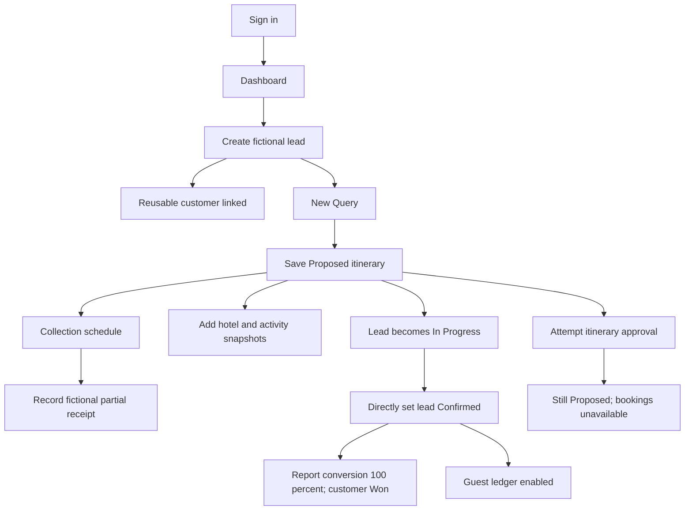

# Observed TripboxCRM connected journey

Owner demo, 2026-10-09. Arrows describe observed transitions or explicit blocked results. [Session](../sessions/2026-10-09.md), [fictional records](../data/test-records.md).

| Step | Observed result | Evidence |
| --- | --- | --- |
| Blank lead submit | Five required-field messages | L004 |
| Save enquiry | Lead #1, customer link; retained on refresh | 004/005 |
| Save custom-service quote | Generated UUID, Proposed; lead subsequently In Progress | L006–008 |
| Hotel pricing | Four nights × 1,000; hotel total 4,000; selling price 15,400 with 10% markup | Additional session notes for editing; retained stay L113 |
| Add activity/save | Benoa Water Sports, 2 adults × 1,200 → 2,400; selling price 18,040 | L069–070/L076 |
| Schedule/receipt | Scheduled 15,400, received 4,000, remaining 11,400; Partial/26.0%; unverified | Additional creation notes; retained state L083/L089 |
| Quote changes | Schedule unchanged; 2,640 unaccounted; temporary zero plan label resolved when payments loaded | L076/L083 |
| Share preview | Earlier 15,400 without activity immediately after save; refresh displays 18,040 and activity | L072–075/L082 |
| Lead Confirmed | Toast/status/history, itinerary still Proposed, report 100%, customer Won | L077–078/L090/L101/L103/L108–109 |
| Guest ledger | Enabled after lead confirmation; debit 15,400, receipt 4,000, balance 11,400; pending verification marked | L110–111 |
| Itinerary approval | Yes dismissed confirmation; Proposed persisted; Bookings unavailable | L071/L078 and additional session notes |

No supplier communication, actual reservation or money movement occurred. Approval failing to reach Confirmed prevents observing supplier booking and voucher operations. Multi-role, agency portal and customer public-link journeys remain unverified. See [coverage](../coverage.md).
